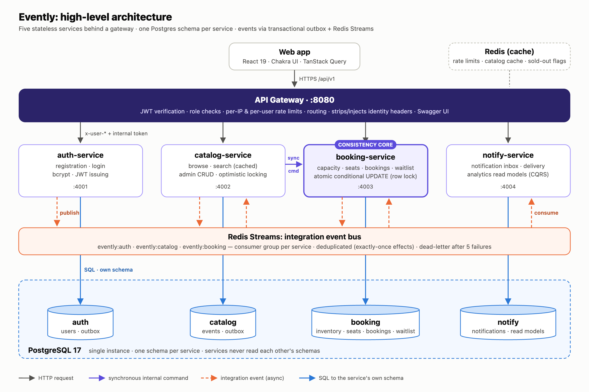

# Evently

A ticketing platform where users browse events, book tickets (general admission or reserved seats), join waitlists and get notified, while admins manage events and view analytics. It is built as **microservices** with a **React + Chakra UI** frontend and engineered so that **tickets can never be oversold**, even when thousands of people book at the same moment.

[](https://github.com/ashwinkothavade/evently/actions/workflows/ci.yml)


> **Live demo:** _to be added after deployment_ · **API docs:** `<gateway>/docs`

## Highlights
- **No overselling, proven.** 200 concurrent requests for 50 tickets → exactly 50 bookings. 50 users racing for one seat → exactly 1 winner. An end-to-end load test (250 users → 100 tickets) sells exactly 100 and passes the integrity audit.
- **Microservices with clear ownership.** A gateway plus auth, catalog, booking and notify services, each owning its own Postgres schema.
- **Reliable events.** A transactional outbox feeds Redis Streams, and idempotent consumers apply each event exactly once.
- **Waitlist with automatic promotion.** Freed tickets are booked for waiting users in the same transaction, so they can't be sniped.
- **Seat maps.** Users pick seats, or get the *best available* seats with parties kept together.
- **Safe retries.** Bookings are idempotent through `Idempotency-Key`.
- **Optimistic locking** for admin edits (`If-Match`, `412` on conflict).
- **Analytics** from event-fed read models: tickets sold, revenue, cancellation rate, utilization, daily trends, popular events and an integrity audit.
- **Notifications** for bookings, cancellations, waitlist promotions and event time or venue changes.
- **Calendar export.** Bookings download as `.ics` files.
- **Consistent UI.** One Chakra UI design system, light and dark mode, colorblind-validated chart palette.

## Architecture



| Component | Port | Responsibility |
|---|---|---|
| [`services/gateway`](services/gateway) | 8080 | Public entry point: auth, rate limiting, routing, Swagger UI |
| [`services/auth-service`](services/auth-service) | 4001 | Users, registration, login, JWT |
| [`services/catalog-service`](services/catalog-service) | 4002 | Event catalog, search, admin event management |
| [`services/booking-service`](services/booking-service) | 4003 | Capacity, seats, bookings, waitlist (the consistency core) |
| [`services/notify-service`](services/notify-service) | 4004 | Notifications and analytics read models |
| [`frontend`](frontend) | 5173 | React web app |
| [`packages/shared`](packages/shared) | — | Shared library: HTTP, Postgres, outbox/streams, contracts |

**How overselling is prevented:** each booking is one transaction that starts with
`UPDATE inventory SET booked_count = booked_count + n WHERE … AND booked_count + n <= capacity`.
Postgres row-locks the event, so concurrent buyers queue up and each one re-checks the guard against the latest value. A `CHECK` constraint backs this up in the schema. Full reasoning: [ADR 0002](docs/adr/0002-booking-concurrency.md).

## Quick start

**Prerequisites:** Node.js ≥ 20.12 and Docker.

```bash
npm install
cp .env.example .env
npm run infra:up      # Postgres 17 + Redis 7
npm run dev           # all services + web app (hot reload)
npm run seed          # demo events, users and bookings
```

| | |
|---|---|
| Web app | http://localhost:5173 |
| API docs (Swagger) | http://localhost:8080/docs |
| Service health | http://localhost:8080/health/services |
| Admin login | `admin@evently.dev` / `admin12345` |
| Demo users (after seeding) | `alice@`, `bob@`, `carol@`, `dan@`, `erin@`, `frank@evently.dev` / `password123` |

**Or run everything in containers:** `docker compose up --build` → http://localhost:3000

## Tests

```bash
npm test                                          # 41 tests: concurrency, integrity, API contract
npm run loadtest -- --users 250 --capacity 100    # end-to-end oversell check with latency stats
```

## Documentation

| Document | What's inside |
|---|---|
| [Design summary](docs/SUMMARY.md) | The 1–2 page overview: decisions, trade-offs, scalability, fault tolerance |
| [System design](docs/DESIGN.md) | Full design: architecture, ER and sequence diagrams, concurrency, scaling |
| [Architecture decisions](docs/adr/README.md) | Eight ADRs with alternatives and consequences |
| [API guide](docs/API.md) | Conventions, examples, endpoint reference, error codes |
| [OpenAPI spec](services/gateway/openapi.yaml) | Machine-readable spec (Swagger UI at `/docs`) |
| [Development](docs/DEVELOPMENT.md) | Local setup, layout, conventions, how to extend |
| [Deployment](docs/DEPLOYMENT.md) | Docker Compose, Render blueprint, environment variables |
| [Testing](docs/TESTING.md) | What the tests prove and the load-test results |
| [Demo script](docs/DEMO.md) | Walkthrough for the video |

## Tech stack
**Backend:** Node.js, TypeScript, Express 5, PostgreSQL 17, Redis 7 (Streams, cache, rate limits), Zod, pino, JWT/bcrypt.
**Frontend:** React 19, Vite, Chakra UI v3, TanStack Query, React Router, Recharts.
**Ops:** Docker, Docker Compose, Render blueprint, GitHub Actions.
