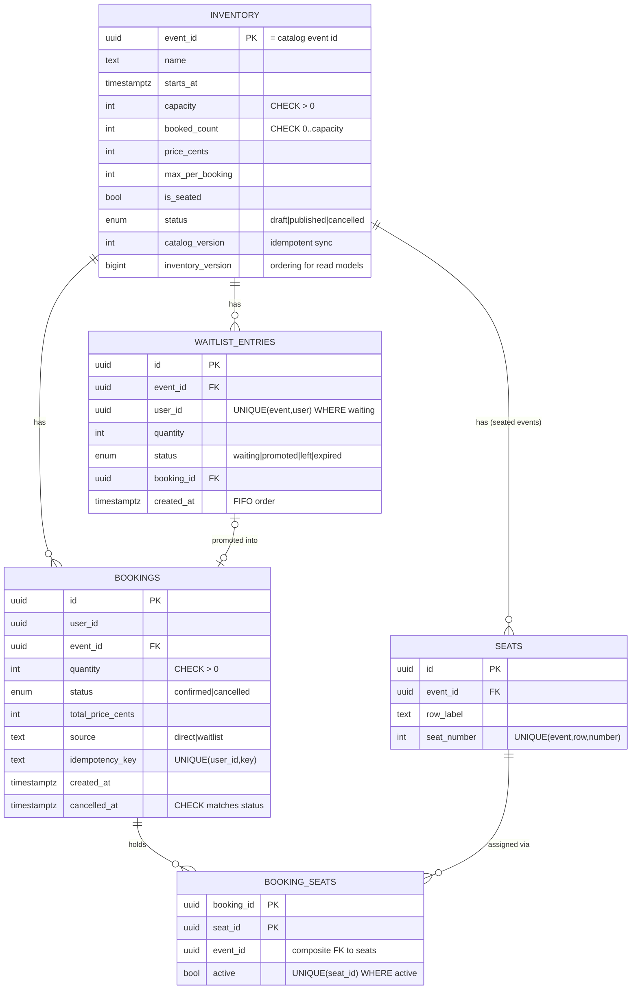
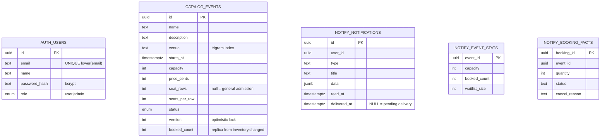
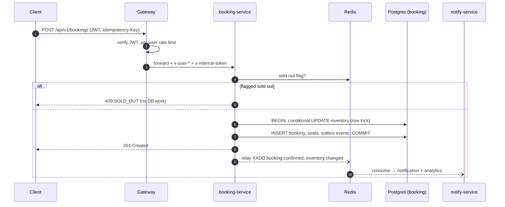
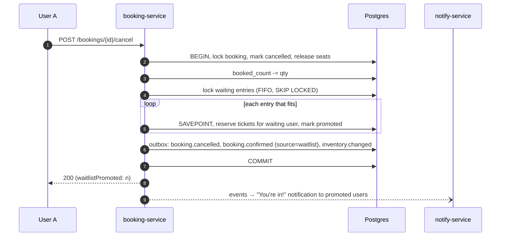
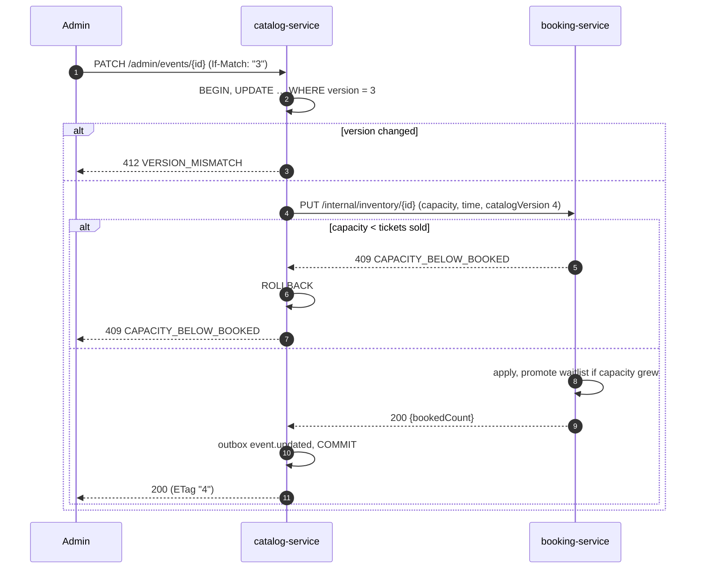

# Evently — System Design

> **Status:** implemented, tested and containerized. See [§12 Implementation status](#12-implementation-status).
> Last updated: 2026-10-24. Short version: [SUMMARY.md](SUMMARY.md). Decision records: [adr/](adr/README.md).

Evently is a ticketing platform. Users browse events, book and cancel tickets (general admission or reserved seats), join waitlists and receive notifications. Admins manage events and view analytics. The hard part is **selling tickets correctly when thousands of people try to book the same event at the same moment**, and doing it on an architecture that scales.

---

## Contents
1. [Goals and non-goals](#1-goals-and-non-goals)
2. [Architecture overview](#2-architecture-overview)
3. [Services and data ownership](#3-services-and-data-ownership)
4. [Inter-service communication](#4-inter-service-communication)
5. [Data model (ER diagrams)](#5-data-model)
6. [Concurrency: how overselling is prevented](#6-concurrency-how-overselling-is-prevented)
7. [Key flows (sequence diagrams)](#7-key-flows)
8. [Scalability](#8-scalability)
9. [Fault tolerance](#9-fault-tolerance)
10. [Security](#10-security)
11. [Trade-offs](#11-trade-offs)
12. [Implementation status](#12-implementation-status)

---

## 1. Goals and non-goals

| Goal | How it is met |
|---|---|
| **No overselling, no double-booked seats** | A single atomic conditional `UPDATE` per booking, plus database `CHECK` constraints and partial unique indexes as backstops (§6) |
| **Scale under booking spikes** | Stateless services, Redis caching, a sold-out fast path, short transactions, rate limiting (§8) |
| **Independent services** | Five services that each own their data; they communicate through a gateway, synchronous commands and asynchronous events (§3–4) |
| **Clean REST API** | Versioned `/api/v1`, consistent envelopes and error codes, OpenAPI spec |
| **Consistent UI** | React app built on a single Chakra UI design system |

**Non-goals:** payments (prices are recorded but not charged), real email delivery (the channel is stubbed behind an interface), multi-region deployment.

---

## 2. Architecture overview


*Source: [`diagrams/architecture.svg`](diagrams/architecture.svg). Arrows: grey = HTTP, purple = synchronous internal command, orange dashed = integration events, blue = SQL to the service's own schema.*

**Repository layout**

```
frontend/                 React + Vite + Chakra UI single-page app
packages/shared/          Code shared by all services: HTTP scaffold, Postgres, outbox/streams, contracts
services/gateway/         Public entry point (port 8080) + openapi.yaml
services/auth-service/    port 4001 · schema "auth"
services/catalog-service/ port 4002 · schema "catalog"
services/booking-service/ port 4003 · schema "booking"
services/notify-service/  port 4004 · schema "notify"
scripts/                  seed.ts (demo data), loadtest.ts (concurrency proof)
docs/                     Design, API guide, ADRs, development, deployment and testing guides
```

---

## 3. Services and data ownership

Each service owns its tables in its own Postgres schema and connects with `search_path` set to that schema. **No service reads another service's tables.** All data sharing goes through APIs or events. A single Postgres instance keeps hosting cheap; moving any schema to its own database requires only a connection-string change.

| Service | Responsibility | Owns (authoritative) | Read models it keeps | Publishes | Consumes |
|---|---|---|---|---|---|
| **gateway** | Edge: JWT verification, role checks, per-IP and per-user rate limits (Redis), routing, CORS, Swagger UI, aggregated health | — | — | — | — |
| **auth-service** | Registration, login, JWT issuing, bootstrap admin | `users` | — | `user.registered` | — |
| **catalog-service** | Event descriptions, browse/search (cached), admin create/update/cancel with optimistic locking | `events` (name, venue, time, price, status, version) | `events.booked_count` (availability for listings) | `event.created`, `event.updated`, `event.cancelled` | `inventory.changed` |
| **booking-service** | **Consistency core:** capacity, seats, bookings, waitlist, idempotency, integrity audit | `inventory`, `seats`, `bookings`, `booking_seats`, `waitlist_entries` | `users` (for attendee lists) | `booking.confirmed`, `booking.cancelled`, `inventory.changed` | `user.registered` |
| **notify-service** | Notification inbox and delivery; admin analytics | `notifications` | `users`, `event_stats`, `booking_facts` | — | everything |

**Why booking-service owns capacity, seats, bookings and the waitlist together:** these must change atomically. Checking capacity, inserting the booking, assigning seats and promoting the waitlist on cancellation all have to happen in **one ACID transaction**. Splitting them across services would require distributed transactions (sagas) and would lose the hard no-oversell guarantee. The service boundary is drawn around the consistency boundary.

---

## 4. Inter-service communication

Two styles, chosen deliberately:

| Style | Used when | Example |
|---|---|---|
| **Synchronous internal HTTP command** | The caller needs an answer *before* it can respond, especially a rejection | Admin lowers capacity → catalog asks booking-service, which rejects with `409 CAPACITY_BELOW_BOOKED` if the new capacity is below tickets already sold |
| **Asynchronous integration event** (Redis Streams) | Something *has happened* and other services update their own views | `booking.confirmed` → notify-service creates a notification and updates analytics |

### 4.1 Transactional outbox (producer side)
A service never writes to Redis inside a business transaction. It inserts the event into its own `outbox` table **in the same transaction** as the change. A background relay then copies committed rows to the service's Redis stream (`XADD`) and marks them published.

- An event exists **if and only if** the business change committed. Rolled-back bookings never emit events, and a crash between commit and publish loses nothing: the relay resumes.
- A Postgres advisory lock ensures only one relay instance publishes at a time, so stream order matches outbox order.
- The relay is "kicked" right after each commit, so typical end-to-end latency is in milliseconds; a 1-second poll is the fallback.

### 4.2 Idempotent consumers (consumer side)
- Each service reads with **its own consumer group**: every service sees every event, and replicas of one service share the load.
- Each event is handled inside a DB transaction that also inserts its id into `processed_events`. A redelivered duplicate hits the primary key and is skipped, so the effect is applied **exactly once**.
- Unacknowledged messages from a crashed consumer are reclaimed with `XAUTOCLAIM`. After 5 failed attempts a message moves to a dead-letter stream (`<stream>:dlq:<group>`).
- Read models use **version guards** (`catalog_version`, `inventory_version`), so out-of-order or replayed events can never move them backwards.
- A new service starts its consumer group at the beginning of the stream and **rebuilds its read models from history**.

### 4.3 Event contracts
Defined once in [`packages/shared/src/contracts.ts`](../packages/shared/src/contracts.ts):

| Event | Producer | Payload (summary) |
|---|---|---|
| `user.registered` | auth | userId, email, name, role |
| `event.created` / `event.updated` / `event.cancelled` | catalog | full event snapshot + version (+ `changed` fields / `reason`) |
| `booking.confirmed` | booking | bookingId, userId, eventId, quantity, total, source (`direct`/`waitlist`), seat labels |
| `booking.cancelled` | booking | bookingId, userId, eventId, quantity, reason (`user`/`admin`/`event_cancelled`) |
| `inventory.changed` | booking | eventId, capacity, bookedCount, waitlistSize, inventoryVersion |

---

## 5. Data model

### 5.1 booking schema (the consistency core)



### 5.2 Other schemas



Every producing service also has `outbox`; every consuming service has `processed_events`.

### 5.3 Integrity rules enforced by the database

| Rule | Mechanism |
|---|---|
| Never sell more than capacity | `CHECK (booked_count BETWEEN 0 AND capacity)` on `inventory` |
| A seat has at most one live booking | `UNIQUE (seat_id) WHERE active` on `booking_seats` |
| A seat belongs to the booked event | Composite FK `(seat_id, event_id) → seats(id, event_id)` |
| One waiting entry per user per event | `UNIQUE (event_id, user_id) WHERE status='waiting'` |
| Retries can't double-book | `UNIQUE (user_id, idempotency_key)` |
| Cancellation is consistent | `CHECK ((status='cancelled') = (cancelled_at IS NOT NULL))` |
| Bookings are history | Never deleted; cancellation is a state change |

`GET /api/v1/admin/analytics/integrity` re-derives `booked_count` from the bookings and active seats and reports any drift.

### 5.4 Indexes

| Index | Query it serves |
|---|---|
| `catalog.events (starts_at, id) WHERE status='published'` | Upcoming-events listing with keyset pagination |
| `catalog.events` GIN trigram on `name`, `venue` | `?q=` search with `ILIKE` |
| `booking.bookings (user_id, created_at DESC, id DESC)` | "My bookings" with keyset pagination |
| `booking.bookings (event_id, status)` | Attendee lists, event cancellation |
| `booking.waitlist_entries (event_id, created_at, id) WHERE status='waiting'` | FIFO queue scan and live positions |
| `booking.booking_seats (event_id) WHERE active` | Seat map |
| `*.outbox (seq) WHERE published_at IS NULL` | Relay polling |
| `notify.booking_facts (created_at)`, `(cancelled_at)` | Daily analytics |
| `notify.notifications (user_id, created_at DESC)` | Inbox |

---

## 6. Concurrency: how overselling is prevented

### 6.1 The core: one atomic conditional update
Every booking runs **one short transaction** in booking-service ([`reservation.ts`](../services/booking-service/src/reservation.ts)) that starts with:

```sql
UPDATE inventory
   SET booked_count = booked_count + $qty
 WHERE event_id = $event
   AND status = 'published'
   AND starts_at > now()
   AND booked_count + $qty <= capacity     -- the guard
   AND $qty <= max_per_booking
RETURNING ...;
```

- Postgres row-locks the inventory row. Concurrent bookings for the same event queue on that lock, and each one re-evaluates the guard against the **latest committed** counter. "Check" and "decrement" are a single atomic step, so there is no window for a race.
- **0 rows updated** means the booking is rejected. A follow-up read explains why: `404`, `409 SOLD_OUT`, `409 INSUFFICIENT_CAPACITY`, `409 EVENT_STARTED`, `409 EVENT_CANCELLED` or `400 QUANTITY_LIMIT_EXCEEDED`.
- In the same transaction: insert the booking, assign seats, append `booking.confirmed` and `inventory.changed` to the outbox, then commit. The lock is held for a few milliseconds.
- **Backstop:** even if the guard were deleted, the `CHECK` constraint would make the transaction fail.

### 6.2 Options considered

| Technique | Verdict |
|---|---|
| **Conditional `UPDATE` (pessimistic row lock)** ✅ | Simple, correct, no retry loop. Cost: bookings for *one* event serialize on that row, which handles hundreds to low thousands of bookings per second per event. |
| `SELECT … FOR UPDATE` then `UPDATE` | Same locking with an extra round trip. |
| Optimistic locking (version + retry) | Under a stampede most attempts conflict and retry, which wastes work. **Used for admin event edits instead** (§6.5), where contention is low. |
| `SERIALIZABLE` isolation | Correct, but produces many serialization failures under load. |
| Redis `DECR` as the source of truth | Very fast, but Redis and Postgres can drift apart. Rejected for correctness; Redis is used only as a *hint* (sold-out flag). |
| Queue with a single consumer per event | Best for extreme drops, but makes booking asynchronous for the client. Documented as the next scaling step (§8.3). |

### 6.3 Seat-level booking
- The client sends `seatIds` (pick on the seat map) or a `quantity` (we auto-assign the **front-most seats, keeping a party in one row** when possible).
- Seats are checked and assigned **after** the inventory row is locked, so seat selection is serialized per event. The partial unique index on `booking_seats` is the safety net. A taken seat returns `409 SEAT_UNAVAILABLE` with the conflicting seat ids.

### 6.4 Idempotency
`POST /bookings` accepts an `Idempotency-Key` header. A retry with the same key returns the **original** booking (`200` with `Idempotent-Replayed: true`) instead of creating another. If concurrent requests with the same key race, the loser hits the unique index and replays the winner's booking. The frontend generates one key per booking attempt.

### 6.5 Optimistic locking for admin edits
Admins send the version they loaded (`If-Match: "3"`). The update runs `WHERE id=$1 AND version=$2`; if someone else edited the event first, the response is `412 VERSION_MISMATCH` with the current version, so two admins never silently overwrite each other.

### 6.6 Waitlist promotion
When tickets are freed (cancellation, capacity increase, draft → published), the **same transaction** promotes the queue:
1. Lock the waiting entries in FIFO order (`FOR UPDATE SKIP LOCKED`).
2. **First-fit:** an entry that needs more tickets than are free is skipped but **keeps its place**, and smaller entries behind it are served. This favors utilization over strict ordering (deliberate trade-off).
3. Each promotion runs in a **savepoint**. If one fails (for example the admin lowered `max_per_booking`), that entry is expired and the cancellation still commits.
4. Promoted users receive a real booking (`source = waitlist`) and a `WAITLIST_PROMOTED` notification.

Because promotion happens inside the transaction that freed the tickets, **nobody can grab them in between**.

### 6.7 Timeouts and deadlocks
- `lock_timeout = 5s` and `statement_timeout = 10s` on every connection. A stuck lock fails fast with `503 BUSY` (`Retry-After: 1`) instead of exhausting the pool.
- The transaction helper retries deadlocks (`40P01`) and serialization failures (`40001`) with jittered backoff.

---

## 7. Key flows

### 7.1 Booking



### 7.2 Cancellation and waitlist promotion



### 7.3 Admin edits an event (synchronous command + optimistic lock)



The inventory sync is idempotent (`catalogVersion`), so retrying after a partial failure is safe. Cancelling an event is also idempotent on the booking side.

---

## 8. Scalability

### 8.1 Read path (browsing is most of the traffic)
- **Catalog cache in Redis** (5s TTL) for listings and details. Admin writes **bump a namespace version** (`catalog:v{n}:…`), invalidating everything instantly with no key scans, across all replicas.
- Responses carry `Cache-Control: public, max-age=5`, so a CDN or browser can absorb repeat reads.
- Availability shown while browsing can be a few seconds stale. That's acceptable because **booking always checks the authoritative counter**.
- **Keyset pagination** on `(starts_at, id)` and `(created_at, id)`: constant cost per page with no `OFFSET` scans.
- **Trigram indexes** make substring search on name and venue index-backed.
- **Analytics run on notify-service's read models (CQRS)**, so admin dashboards put zero load on the booking database.

### 8.2 Write path (booking spikes)
- **Sold-out fast path:** after a `SOLD_OUT`, a 2-second Redis flag rejects further attempts without touching Postgres. Cancellations clear it. A herd hitting a sold-out event costs almost nothing.
- **Short transactions** (about 6 statements, milliseconds of lock time) and bounded connection pools (`DB_POOL_MAX`). Excess load queues in the app, not in Postgres.
- **Rate limits in Redis** (shared by all gateway replicas): per-IP globally and per-user on `POST /bookings`. Responses are `429` with `RateLimit-*` headers.
- **Horizontal scaling:** every service is stateless. Relays (advisory lock), consumers (consumer groups, `SKIP LOCKED`) and migrations (advisory lock) are safe with any number of replicas.
- **Independent scaling:** booking-service can run many replicas during an on-sale while auth and notify stay small.

### 8.3 Next steps (designed, not built)
1. **Read replicas** for catalog listings.
2. **Sharding booking-service by `event_id`.** Everything a booking transaction touches is keyed by event, so it never crosses shards. "My bookings" becomes a scatter-gather query, or a per-user index fed by events.
3. **Queue-based admission for mega drops:** requests enter a per-event queue and one worker drains it in order. This gives fairness and flat database load at the cost of asynchronous confirmation (the client polls or receives a push).
4. **Real delivery channels** (email/SMS/push) behind the existing `NotificationChannel` interface.

---

## 9. Fault tolerance

| Failure | Behavior |
|---|---|
| Redis cache unavailable | Cache operations **fail open**: requests go to Postgres |
| Redis streams unavailable | Business writes still commit; events wait in the outbox and are relayed when Redis returns |
| A consumer crashes mid-message | The message stays pending and another instance reclaims it with `XAUTOCLAIM` |
| Poison message | Retried 5 times, then moved to a dead-letter stream; the consumer keeps going |
| booking-service down during an admin edit | The catalog transaction rolls back and the admin gets `503`; nothing is half-applied |
| A service is down | The gateway returns `502 UPSTREAM_UNAVAILABLE`; `/health/services` shows which one |
| Several replicas boot at once | Migrations serialize on an advisory lock |
| Deploy / scale-in | `SIGTERM` → stop accepting connections, drain relays and consumers, close pools |
| Lock contention | `lock_timeout` → `503 BUSY` with `Retry-After`; clients retry safely thanks to idempotency keys |

---

## 10. Security
- **JWT** (HS256) issued by auth-service and verified **only at the gateway**. Passwords are hashed with bcrypt; login takes the same time whether or not the email exists, so it doesn't reveal accounts.
- The gateway **strips** client-supplied `x-user-*` and `x-internal-token` headers, then injects the verified identity.
- **Services reject any request without the internal token** (constant-time comparison), so they can't be called directly even if publicly reachable.
- `/internal/*` routes are not in the gateway routing table and return 404 at the edge.
- Role checks happen at the gateway **and** in each service (defense in depth).
- Requests are validated with Zod. SQL is always parameterized. Helmet sets security headers, and CORS is restricted by `CORS_ORIGINS`.
- Other users' bookings return `404`, not `403`, so ids can't be probed.

---

## 11. Trade-offs

| Decision | Benefit | Cost |
|---|---|---|
| Booking consistency in one service | Hard no-oversell guarantee with plain ACID transactions | booking-service is the largest service |
| Pessimistic row lock per event | Simple and provably correct | Per-event write throughput is bounded (hot row) |
| One Postgres, schema per service | Cheap to host; ownership still enforced | Shared failure domain for the database (easy to split later) |
| Redis Streams instead of Kafka/RabbitMQ | One small dependency that also serves cache and rate limits | Less tooling and retention than Kafka |
| Outbox + idempotent consumers | Exactly-once effects, no lost events | Read models are eventually consistent (milliseconds) |
| Sync command for capacity changes | Admin gets an immediate, correct rejection | Catalog depends on booking-service being up for edits |
| First-fit waitlist | Higher seat utilization | Not strictly FIFO for large parties |
| Short-TTL catalog cache | Cheap browsing at scale | Displayed availability can be ~5s stale |
| Raw SQL over an ORM | Locking is explicit and reviewable | More boilerplate |

---

## 12. Implementation status

| Area | Status | Notes |
|---|---|---|
| Shared library (`packages/shared`) | ✅ Done | HTTP scaffold, Postgres helpers, outbox relay, stream consumer, contracts |
| auth-service | ✅ Done | Register, login, `/me`, bootstrap admin, `user.registered` |
| catalog-service | ✅ Done | Browse/search/paginate (cached), admin CRUD with optimistic locking, cancel |
| booking-service | ✅ Done | Atomic booking, seats (pick or auto), idempotency, cancel, waitlist auto-promotion, `.ics`, integrity audit |
| notify-service | ✅ Done | Projections, notifications for every event type, delivery dispatcher, analytics |
| Gateway | ✅ Done | JWT, roles, Redis rate limits, routing, Swagger UI, `/health/services` |
| Frontend (React + Chakra UI) | ✅ Done | Events, seat picker, bookings, waitlist, notifications, admin events, analytics dashboard; light and dark mode |
| OpenAPI spec | ✅ Done | 29 operations, validated, served at `/docs` |
| Automated tests | ✅ 41/41 passing | 11 concurrency/integrity tests (real Postgres + Redis), 30 API contract tests |
| Load test | ✅ Passing | 250 concurrent users → exactly 100 of 100 tickets sold, integrity OK |
| Containers | ✅ Done | One Dockerfile for all services, nginx image for the web app, full-stack `docker-compose.yml` (verified) |
| CI | ✅ Done | GitHub Actions: typecheck, tests, build, Docker images |
| Render blueprint | ✅ Written | `render.yaml`; not yet deployed (needs a Render account) |
| Documentation | ✅ Done | See the index below |
| Deployment | ⏳ Pending | Needs a GitHub repository and a Render (or other) account |

### Documentation index
| Document | For |
|---|---|
| [README](../README.md) | Overview and quick start |
| [SUMMARY.md](SUMMARY.md) | The 1–2 page design summary |
| [DESIGN.md](DESIGN.md) | This document: full design and diagrams |
| [adr/](adr/README.md) | Architecture decision records |
| [API.md](API.md) + [`openapi.yaml`](../services/gateway/openapi.yaml) | API guide, error codes, full spec |
| [DEVELOPMENT.md](DEVELOPMENT.md) | Local setup, conventions, how to extend |
| [DEPLOYMENT.md](DEPLOYMENT.md) | Docker, Render, environment variables |
| [TESTING.md](TESTING.md) | Test strategy and results |
| [DEMO.md](DEMO.md) | Video walkthrough script |
| `services/*/README.md`, `packages/shared/README.md`, `frontend/README.md` | Per-component reference |
